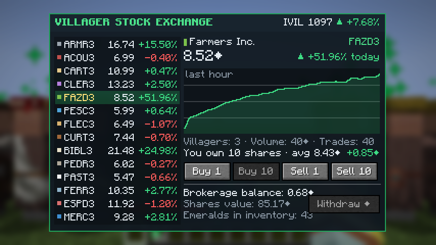

# Bolsa dos Villagers

Mod para **Minecraft Java 26.2** (Fabric) que cria uma **bolsa de valores movida pela economia dos villagers**.
Cada profissão é uma empresa listada. As trocas, as reposições de estoque, os nascimentos, as mortes e as
mudanças de profissão mexem nas cotações. Você investe suas esmeraldas e lucra (ou perde) com isso.



## Como jogar

- **Terminal da Bolsa**: um bloco que você fabrica e coloca no mundo. Clique com o botão direito para abrir o
  "home broker", com todas as ações, um gráfico da última hora, sua carteira e os botões de compra e venda.
- **Na tela de trocas do villager**: ao abrir as trocas, aparece colado à tela um painel com a ação da
  guilda daquele villager, um mini-gráfico, o efeito da bolsa no preço das trocas e botões para comprar e
  vender ali mesmo.
- **Os villagers sentem o mercado**: quando a ação da guilda sobe forte, eles soltam brilhos verdes. Quando cai,
  ficam bravos.
- **A bolsa afeta as trocas**: uma guilda valorizada cobra mais caro pelos produtos e pede menos itens quando
  compra de você. Uma guilda em baixa entra em promoção. O efeito máximo é de ±30%.

| Painel lateral (tela larga) | Faixa compacta (GUI grande) |
|---|---|
|  |  |

### Receita do Terminal

```
Vidro  Vidro   Vidro          (painéis de vidro)
Esm.   Redst.  Esm.           (esmeralda, redstone, esmeralda)
Tábua  Atril   Tábua          (qualquer tábua, atril, qualquer tábua)
```

A receita aparece no livro de receitas assim que você pega a primeira esmeralda.

### Dinheiro

- Os preços são em esmeraldas (◆), com centavos.
- Ao comprar, o valor sai do **saldo da corretora**. Se o saldo não bastar, as esmeraldas saem direto da mochila
  e o troco fica no saldo.
- O valor das vendas vai para o saldo. O botão **Sacar ◆** transforma o saldo em esmeraldas de verdade.
- A corretagem é de 1% por ordem. Cada ordem também move o preço (impacto de mercado), e você paga o preço
  médio desse movimento, então comprar e vender em seguida nunca dá lucro.

## As empresas

| Ticker | Empresa | Profissão |
|---|---|---|
| ARMR3 | Armeiros S.A. | Armeiro (armaduras) |
| ACOU3 | Açougues Unidos | Açougueiro |
| CART3 | Cartógrafos & Cia | Cartógrafo |
| CLER3 | Igreja do Clérigo | Clérigo |
| FAZD3 | Fazendeiros S.A. | Agricultor |
| PESC3 | Pescados do Rio | Pescador |
| FLEC3 | Flechas & Arcos | Flecheiro |
| CURT3 | Curtume Villager | Coureiro |
| BIBL3 | Biblioteca Arcana | Bibliotecário |
| PEDR3 | Pedreiras Reunidas | Pedreiro |
| PAST3 | Lãs do Pastor | Pastor |
| FERR3 | Ferramentaria Forte | Ferramenteiro |
| ESPD3 | Espadas do Ferreiro | Armeiro (armas) |
| MERC3 | Mercador Ambulante | Mercador ambulante |

O índice **IVIL** resume o mercado inteiro e começa em 1000 pontos.

## Como o preço se move

Há um pregão a cada 30 segundos (600 ticks). Em cada pregão, cada ação varia assim:

```
retorno = pressão dos eventos + 0,08 × ln(valor justo ÷ preço) + ruído aleatório (σ ≈ 0,6%)
preço   = preço × e^retorno         (limitado a ±15% por pregão)
```

- **Valor justo** = preço base × (0,5 + 0,5 × √(1 + villagers da profissão)). Uma vila com mais agricultores
  vale mais.
- **Pressão dos eventos** acumulada entre pregões:
  - Jogador comprando da guilda (pagando esmeraldas): +0,4% por esmeralda.
  - Jogador vendendo para a guilda: +0,15% por esmeralda.
  - Uma oferta que esgota: +1% (escassez).
  - Reposição de estoque no posto de trabalho: +0,3%.
  - Villager novo na profissão: +2,5%. Perda de um villager: −2,5%.
  - Morte de um villager: −4,5%. Se foi morto por um jogador: −7% (escândalo).
- O **censo** lembra dos villagers mesmo com o chunk descarregado. Só sai dele quem morre, vira zumbi ou some.
- A abertura do dia (para a variação "hoje") é reiniciada a cada dia do Minecraft.

Tudo fica salvo no mundo, em `data/bolsavillager_market.dat`.

## Instalação

1. Instale o [Fabric Loader](https://fabricmc.net/use/) para o Minecraft 26.2.
2. Coloque na pasta `mods` o [Fabric API](https://modrinth.com/mod/fabric-api) para 26.2 e o
   `bolsa-villagers-0.1.0.jar`.
3. Em servidor, o mod precisa estar **no servidor e em todos os clientes**.

## Compilar

Precisa do Java 25.

```bash
./gradlew build
```

O jar sai em `build/libs/bolsa-villagers-<versão>.jar`.

Para abrir o jogo de desenvolvimento:

```bash
./gradlew runClient
```

### Teste automatizado

Este teste abre o jogo de verdade, cria um mundo com villagers e o terminal, simula 40 pregões com trocas,
compra pelo terminal, compra e vende pela tela do villager, saca o saldo e reabre o mundo para conferir se
tudo foi salvo:

```bash
./gradlew runClientGameTest
```

As capturas de tela ficam em `build/run/clientGameTest/screenshots/`. Num servidor sem tela, rode o comando
com `xvfb-run -a`.

## Estrutura do código

```
src/main/java/br/bolsavillager/
  BolsaMod.java            registro do bloco, rede e eventos
  block/TerminalBlock.java bloco do terminal
  market/StockDef.java     as empresas (profissão, ticker, preço base)
  market/MarketEngine.java pregão, eventos, compra/venda
  market/MarketData.java   dados salvos (cotações, contas, censo)
  mixin/                   ganchos em trocas, reposição e preços dos villagers
  net/                     pacotes cliente <-> servidor
src/client/java/br/bolsavillager/client/
  screen/TerminalScreen.java home broker
  screen/VillagerPanel.java  painel na tela de trocas
  screen/MarketUi.java       gráfico e cores
src/gametest/              teste automatizado do cliente
```
