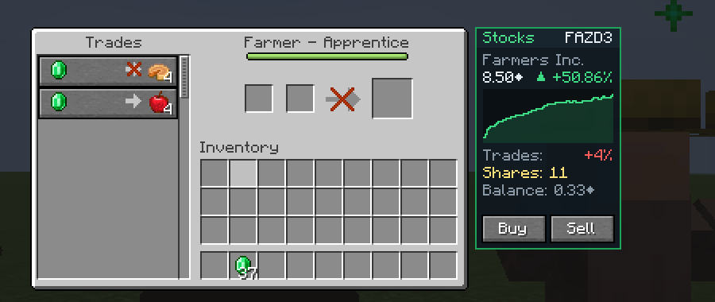
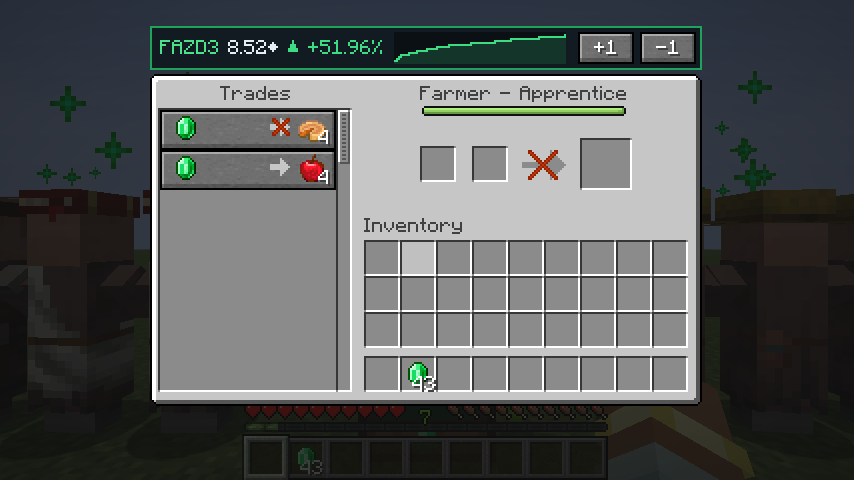
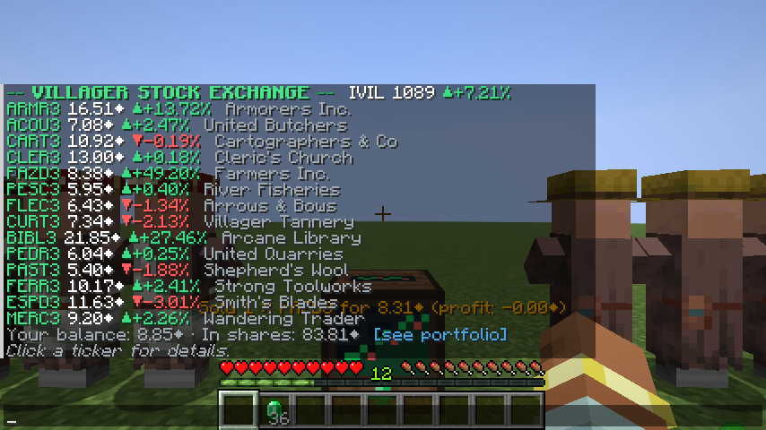
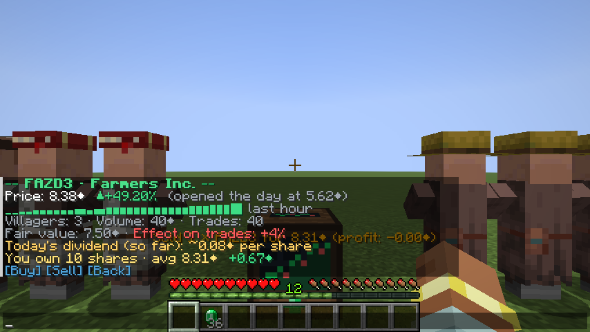
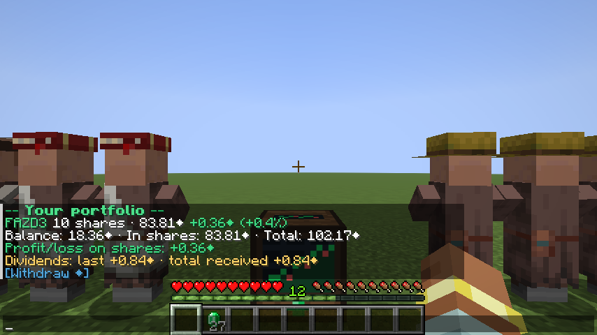

# Bolsa dos Villagers

Mod para **Minecraft Java 26.2** (Fabric) que cria uma **bolsa de valores movida pela economia dos villagers**.
Cada profissão é uma empresa listada. As trocas, as reposições de estoque, os nascimentos, as mortes e as
mudanças de profissão mexem nas cotações. Você investe suas esmeraldas e lucra (ou perde) com isso.


## Como jogar

- **Terminal da Bolsa**: um bloco que você fabrica e coloca no mundo. Clique com o botão direito para abrir o
  "home broker", com todas as ações, um gráfico da última hora, sua carteira e os botões de compra e venda.
- **Na tela de trocas do villager**: ao abrir as trocas, aparece colado à tela um painel com a ação da
  guilda daquele villager, um mini-gráfico, o efeito da bolsa no preço das trocas e botões para comprar e
  vender ali mesmo.
- **Os villagers sentem o mercado**: quando a ação da guilda sobe forte, eles soltam brilhos verdes. Quando cai,
  ficam bravos.
- **A bolsa afeta as trocas**: uma guilda valorizada cobra mais caro pelos produtos e pede menos itens quando
  compra de você. Uma guilda em baixa entra em promoção. O efeito máximo é de ±30%.

| Painel lateral (tela larga) | Faixa compacta (GUI grande) |
|---|---|
|  |  |

### Receita do Terminal

```
Vidro  Vidro   Vidro          (painéis de vidro)
Esm.   Redst.  Esm.           (esmeralda, redstone, esmeralda)
Tábua  Atril   Tábua          (qualquer tábua, atril, qualquer tábua)
```

A receita aparece no livro de receitas assim que você pega a primeira esmeralda.

### Dinheiro

- Os preços são em esmeraldas (◆), com centavos.
- Ao comprar, o valor sai do **saldo da corretora**. Se o saldo não bastar, as esmeraldas saem direto da mochila
  e o troco fica no saldo.
- O valor das vendas vai para o saldo. O botão **Sacar ◆** transforma o saldo em esmeraldas de verdade.
- A corretagem é de 1% por ordem. Cada ordem também move o preço (impacto de mercado), e você paga o preço
  médio desse movimento, então comprar e vender em seguida nunca dá lucro.

## Comando /bolsa

Funciona em qualquer lugar para consultar. Para comprar ou vender pelo chat, você precisa estar perto de um
Terminal da Bolsa, a não ser que a configuração `chatTradingAnywhere` esteja ligada. Os tickers aceitam letra
maiúscula ou minúscula, e o Tab completa.

| Comando | O que faz |
|---|---|
| `/bolsa` | Visão geral: índice IVIL, todas as ações e o seu saldo. Clique num ticker para ver detalhes. |
| `/bolsa <ticker>` | Detalhes: preço, gráfico da última hora, villagers, volume, valor justo, efeito nas trocas, dividendo previsto, sua posição e botões de comprar/vender. |
| `/bolsa carteira` | Suas ações com lucro/prejuízo, saldo, total e dividendos recebidos. |
| `/bolsa comprar <ticker> [qtd]` | Compra de 1 a 64 ações (o padrão é 1). |
| `/bolsa vender <ticker> [qtd]` | Vende de 1 a 64 ações. |
| `/bolsa vender <ticker> tudo` | Vende todas as ações da empresa. |
| `/bolsa sacar` | Transforma o saldo da corretora em esmeraldas. |
| `/bolsa admin pregao [vezes]` | (op) Roda pregões na hora. |
| `/bolsa admin dividendos` | (op) Paga os dividendos do dia na hora. |
| `/bolsa admin recarregar` | (op) Relê o arquivo de configuração. |

| Visão geral | Detalhes | Carteira |
|---|---|---|
|  |  |  |

## Dividendos

Toda vez que vira o dia no Minecraft, cada empresa paga dividendos a quem tem ações dela. O valor cai direto
no saldo da corretora, inclusive para quem está offline. Quem está online recebe um aviso no chat, e passar o
mouse sobre ele mostra quanto veio de cada empresa.

```
dividendo por ação = preço × (0,2% + 0,8% × min(1, trocas do dia ÷ 12))
```

- Toda guilda com pelo menos um villager paga o mínimo de 0,2% ao dia.
- Quanto mais trocas com villagers daquela profissão no dia, maior o dividendo, até 1% ao dia com 12 trocas.
- O mercador ambulante só paga se teve alguma troca no dia.
- O terminal e o `/bolsa <ticker>` mostram o dividendo previsto do dia. O terminal e o `/bolsa carteira`
  mostram o último dividendo recebido.

Com os valores padrão, comprar antes da virada do dia e vender logo depois não compensa: a corretagem de ida e
volta (2%) é maior que o dividendo máximo (1%). Se você mudar a configuração, mantenha
`dividendBaseYield + dividendActivityYield` abaixo de `2 × brokerageFee`.

## Configuração

O arquivo `config/bolsavillager.json` é criado na primeira vez que o jogo abre. Edite e use
`/bolsa admin recarregar` (ou reinicie). Valores fora da faixa são corrigidos sozinhos. Em multiplayer vale a
configuração do servidor: ele manda as regras para os clientes, que mostram os custos certos.

| Opção | Padrão | O que faz |
|---|---|---|
| `sessionIntervalTicks` | 600 | Ticks entre pregões (20 = 1 s; 600 = 30 s). |
| `volatility` | 0.006 | Ruído aleatório por pregão (0,6%). Use 0 para só os villagers mexerem no preço. |
| `meanReversion` | 0.08 | Quanto o preço volta ao valor justo por pregão. |
| `maxMovePerSession` | 0.15 | Variação máxima de um pregão (±15%). |
| `eventStrength` | 1.0 | Multiplica o efeito de todos os eventos dos villagers (2 = o dobro). |
| `villagerParticles` | true | Villagers comemoram/reclamam com partículas. |
| `tradePriceEffect` | 0.3 | Quanto a cotação muda o preço das trocas. Use 0 para desligar. |
| `tradePriceEffectMax` | 0.3 | Limite do efeito nas trocas (±30%). |
| `brokerageFee` | 0.01 | Corretagem por ordem (1%). |
| `marketImpactPerShare` | 0.004 | Quanto cada ação negociada move o preço (0,4%). |
| `chatTradingAnywhere` | false | Permite `/bolsa comprar/vender` longe do terminal. |
| `terminalRange` | 8 | Distância máxima (em blocos) do terminal para negociar. |
| `dividendsEnabled` | true | Liga/desliga os dividendos. |
| `dividendBaseYield` | 0.002 | Dividendo mínimo por dia (0,2% do preço). |
| `dividendActivityYield` | 0.008 | Dividendo extra por movimento (até +0,8%). |
| `dividendTradesTarget` | 12 | Trocas no dia para o dividendo extra completo. |

## As empresas

| Ticker | Empresa | Profissão |
|---|---|---|
| ARMR3 | Armeiros S.A. | Armeiro (armaduras) |
| ACOU3 | Açougues Unidos | Açougueiro |
| CART3 | Cartógrafos & Cia | Cartógrafo |
| CLER3 | Igreja do Clérigo | Clérigo |
| FAZD3 | Fazendeiros S.A. | Agricultor |
| PESC3 | Pescados do Rio | Pescador |
| FLEC3 | Flechas & Arcos | Flecheiro |
| CURT3 | Curtume Villager | Coureiro |
| BIBL3 | Biblioteca Arcana | Bibliotecário |
| PEDR3 | Pedreiras Reunidas | Pedreiro |
| PAST3 | Lãs do Pastor | Pastor |
| FERR3 | Ferramentaria Forte | Ferramenteiro |
| ESPD3 | Espadas do Ferreiro | Armeiro (armas) |
| MERC3 | Mercador Ambulante | Mercador ambulante |

O índice **IVIL** resume o mercado inteiro e começa em 1000 pontos.

## Como o preço se move

Há um pregão a cada 30 segundos (`sessionIntervalTicks`). Em cada pregão, cada ação varia assim:

```
retorno = eventStrength × pressão dos eventos + meanReversion × ln(valor justo ÷ preço) + ruído (σ = volatility)
preço   = preço × e^retorno         (limitado a ±maxMovePerSession)
```

- **Valor justo** = preço base × (0,5 + 0,5 × √(1 + villagers da profissão)). Uma vila com mais agricultores
  vale mais.
- **Pressão dos eventos** acumulada entre pregões:
  - Jogador comprando da guilda (pagando esmeraldas): +0,4% por esmeralda.
  - Jogador vendendo para a guilda: +0,15% por esmeralda.
  - Uma oferta que esgota: +1% (escassez).
  - Reposição de estoque no posto de trabalho: +0,3%.
  - Villager novo na profissão: +2,5%. Perda de um villager: −2,5%.
  - Morte de um villager: −4,5%. Se foi morto por um jogador: −7% (escândalo).
- O **censo** lembra dos villagers mesmo com o chunk descarregado. Só sai dele quem morre, vira zumbi ou some.
- A abertura do dia (para a variação "hoje") é reiniciada a cada dia do Minecraft.

Tudo fica salvo no mundo, em `data/bolsavillager_market.dat`.

## Instalação

1. Instale o [Fabric Loader](https://fabricmc.net/use/) para o Minecraft 26.2.
2. Coloque na pasta `mods` o [Fabric API](https://modrinth.com/mod/fabric-api) para 26.2 e o
   `bolsa-villagers-0.1.0.jar`.
3. Em servidor, o mod precisa estar **no servidor e em todos os clientes**.

## Compilar

Precisa do Java 25.

```bash
./gradlew build
```

O jar sai em `build/libs/bolsa-villagers-<versão>.jar`.

Para abrir o jogo de desenvolvimento:

```bash
./gradlew runClient
```

### Teste automatizado

Este teste abre o jogo de verdade e faz o seguinte:

- cria um mundo com villagers e o terminal;
- simula 40 pregões com trocas;
- compra pelo terminal e compra e vende pela tela do villager;
- usa o `/bolsa` (visão geral, detalhes, carteira, comprar, vender e sacar);
- paga dividendos e confere o valor;
- recarrega a configuração;
- reabre o mundo para conferir se tudo foi salvo.

Para rodar:

```bash
./gradlew runClientGameTest
```

As capturas de tela ficam em `build/run/clientGameTest/screenshots/`. Num servidor sem tela, rode o comando
com `xvfb-run -a`.

## Estrutura do código

```
src/main/java/br/bolsavillager/
  BolsaMod.java            registro do bloco, rede, eventos e comando
  BolsaCommand.java        comando /bolsa
  BolsaConfig.java         config/bolsavillager.json
  block/TerminalBlock.java bloco do terminal
  market/StockDef.java     as empresas (profissão, ticker, preço base)
  market/MarketEngine.java pregão, eventos, compra/venda, dividendos
  market/MarketRules.java  regras compartilhadas com o cliente (custos, efeito nas trocas, dividendos)
  market/MarketData.java   dados salvos (cotações, contas, censo)
  mixin/                   ganchos em trocas, reposição e preços dos villagers
  net/                     pacotes cliente <-> servidor
src/client/java/br/bolsavillager/client/
  screen/TerminalScreen.java home broker
  screen/VillagerPanel.java  painel na tela de trocas
  screen/MarketUi.java       gráfico e cores
src/gametest/              teste automatizado do cliente
```
