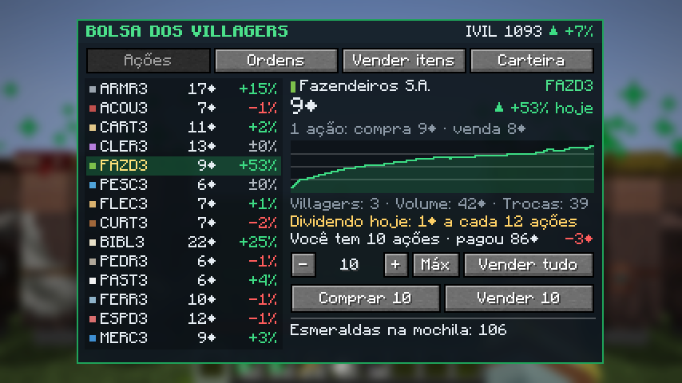
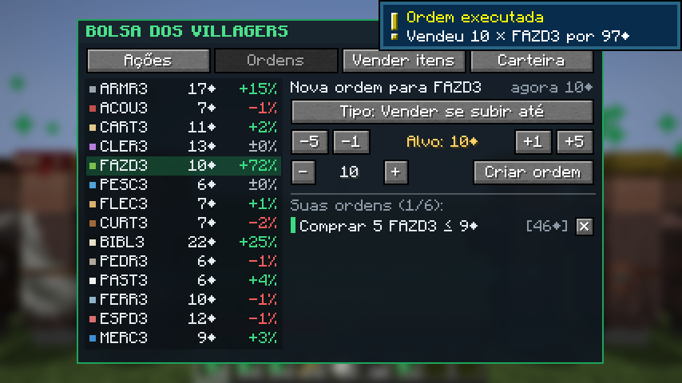
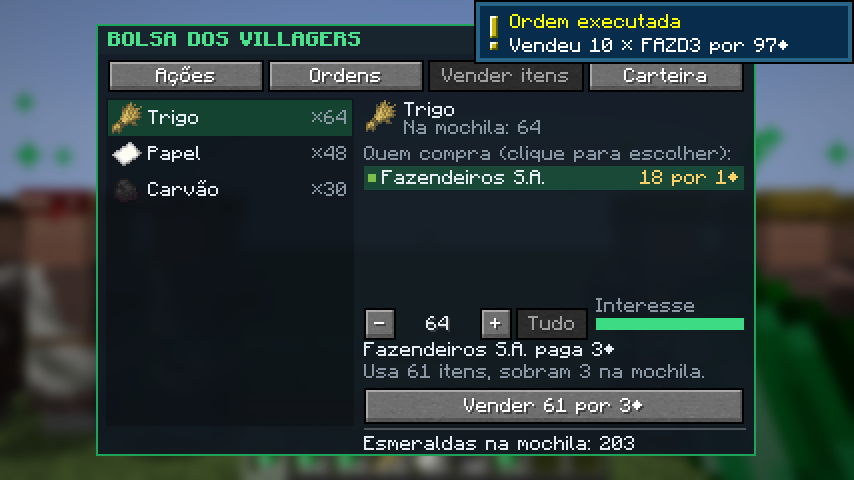
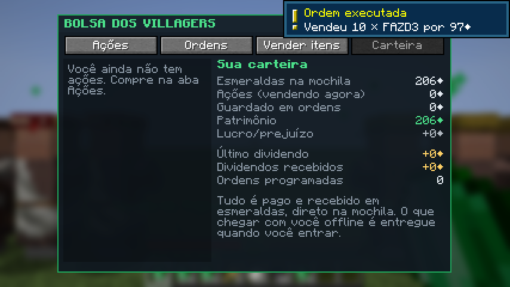
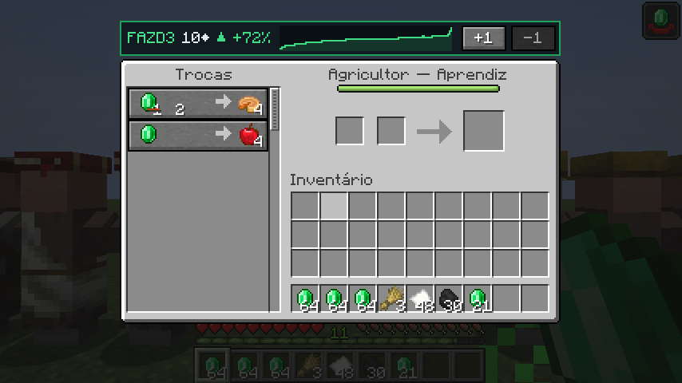
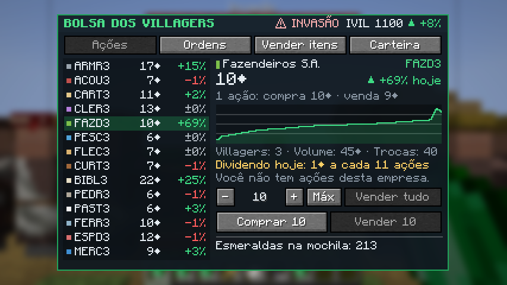

# Bolsa dos Villagers

Mod para **Minecraft Java 26.2** (Fabric) que cria uma **bolsa de valores movida pela economia dos villagers**.
Cada profissão é uma empresa listada. As trocas, as reposições de estoque, os nascimentos, as mortes, as
mudanças de profissão e as invasões (raids) mexem nas cotações. Você investe suas esmeraldas e lucra (ou
perde) com isso, e também pode vender itens para as guildas, que decidem quanto pagam.

Tudo em português, sem chat e sem blocos: aperte **B** em qualquer lugar. Todo pagamento é em
**esmeraldas inteiras**, direto da mochila e para a mochila.



## Como jogar

Aperte **B** (dá para trocar em *Opções → Controles → Bolsa dos Villagers*). A tela tem quatro abas:

| Aba | O que faz |
|---|---|
| **Ações** | Lista de empresas, gráfico da última hora, quanto custa e quanto rende 1 ação, sua posição e o dividendo previsto. Escolha a quantidade (1, 2, 5, 10, 16, 32, 64 ou **Máx**) e compre ou venda na hora. **Vender tudo** zera a posição. |
| **Ordens** | Ordens programadas, executadas sozinhas num pregão quando a cotação chega no alvo, mesmo com você offline: **comprar se cair até**, **vender se subir até** (realizar lucro) e **stop: vender se cair até** (limitar prejuízo). O alvo é ajustado de 1 em 1 ou de 5 em 5 esmeraldas. Até 6 ordens. |
| **Vender itens** | O balcão: escolha um item da mochila e veja quais guildas compram e quanto cada uma oferece. O preço quem decide é a guilda (veja abaixo). |
| **Carteira** | Esmeraldas na mochila, quanto suas ações rendem se vender agora, o que está guardado em ordens, patrimônio, lucro/prejuízo e dividendos. |

| Ordens | Vender itens | Carteira |
|---|---|---|
|  |  |  |

**Na tela de trocas do villager** aparece um painel com a ação da guilda dele, um mini-gráfico, o efeito da
bolsa no preço das trocas e botões para comprar e vender ali mesmo.



**Avisos** (dividendos, ordem executada, invasão) aparecem como notificação no canto da tela. Confirmações de
compra e venda aparecem em cima da barra de itens. Nada vai para o chat.

### Dinheiro: só esmeraldas inteiras

- Não existe saldo virtual nem centavos. **Comprar** tira esmeraldas da mochila; **vender**, ordens executadas,
  vendas no balcão e dividendos **põem esmeraldas na mochila** (se estiver cheia, elas caem no chão perto de você).
- A cotação aparece arredondada (ex.: 8◆). O preço real de 1 ação também aparece em inteiros, como
  "compra 9◆ · venda 8◆": a corretagem e o arredondamento já estão incluídos. Compras arredondam para
  cima e vendas para baixo, então comprar e vender em seguida nunca dá lucro.
- **Ordens de compra programadas guardam as esmeraldas na hora em que são criadas**, para poderem rodar com
  você offline. Cancelar devolve tudo; se a compra sair mais barata que o alvo, o troco volta.
- O que chegar enquanto você estiver offline (ordem executada, dividendo) é entregue assim que você entrar no
  mundo, com uma notificação.

## Balcão: vender itens para as guildas

Cada guilda compra o que os villagers dela compram nas trocas normais: agricultores compram trigo, batata e
abóbora; bibliotecários e cartógrafos, papel; armeiros e ferramenteiros, carvão, ferro e diamante; e assim por
diante. Quando mais de uma guilda compra o mesmo item, a tela mostra todas, e a escolhida de início é a que
paga melhor.

Quem decide o preço é a guilda:

```
valor da 1ª unidade = (1 ÷ unidades por esmeralda nas trocas) × prosperidade × bônus do Herói
prosperidade        = √(cotação ÷ valor justo), entre 0,6 e 1,5
```

A guilda paga em **esmeraldas inteiras** (arredondando para baixo), e a tela mostra a oferta como
"18 por 1◆". Para você não entregar item de graça por causa do arredondamento, só sai da mochila a menor
quantidade que rende aquele pagamento. Por exemplo, com 64 trigos a guilda paga 3◆ por 61 e os outros 3 ficam
na mochila.

- **Guilda valorizada paga mais**, guilda em crise paga menos.
- **Guilda sem nenhum villager não compra nada.**
- **A guilda enjoa:** quanto mais ela compra de um item no dia, menos paga por unidade. A barra de
  **Interesse** mostra isso, e ela volta a 100% no dia seguinte. Guildas maiores absorvem mais.
- Itens danificados ou encantados não entram no balcão.
- Cada venda conta como movimento da guilda: sobe um pouco a ação, entra no volume e nas trocas do dia
  (que aumentam os dividendos).

## Trocas nunca travam (adeus, X vermelho)

No jogo normal, depois de algumas trocas o villager "esgota" a oferta: aparece um X vermelho e você não
consegue mais comprar até ele repor o estoque no posto de trabalho. Com o mod, **a troca nunca trava**. No lugar
do bloqueio entra um **ágio de escassez**:

- Enquanto há estoque normal, o preço é o de sempre.
- Cada troca além do estoque normal custa **+25% do preço base a mais**, sempre arredondado para cima e com no
  mínimo +1 item. A 1ª troca extra custa +25%, a 2ª +50% e assim por diante, até o limite de uma pilha.
- A tela de trocas mostra o preço normal riscado e o novo preço ao lado.
- Quando o villager repõe o estoque, o preço volta ao normal (o jogo ainda pode subir um pouco o preço pela
  procura, como no Minecraft normal).
- Passar do estoque também conta como escassez na bolsa: a ação da guilda sobe um pouco.

Dá para ajustar o ágio (`scarcitySurchargePerExtraTrade`) ou voltar ao bloqueio normal
(`unlimitedTrades: false`) na configuração.

## Raids e descontos

| Situação | Efeito |
|---|---|
| Raid começa (primeira onda) | Ações das guildas da vila atacada caem 4% e aparece **⚠ INVASÃO** na tela da bolsa |
| Raid em andamento | −1% a mais por pregão |
| Vitória | +6% para as guildas da vila |
| Derrota | −12% |

"Guildas da vila" são as profissões dos villagers a até 96 blocos do centro do raid.

**Descontos de troca continuam funcionando.** O jogo aplica primeiro os descontos normais (reputação e Herói
da Vila) e depois a bolsa ajusta o preço:

- Guilda valorizada cobra mais caro e, quando compra de você, pede menos itens.
- Guilda em baixa entra em promoção.
- O efeito vai até ±30%.
- **Quem tem o efeito Herói da Vila nunca paga a alta da bolsa**, só aproveita as promoções.

O Herói da Vila também ganha vantagens na bolsa: **corretagem pela metade** e **+10% no balcão** (+5% por
nível extra). A tela mostra uma linha dourada quando o efeito está ativo.



## Dividendos

Toda vez que vira o dia no Minecraft, cada empresa paga dividendos a quem tem ações dela, em esmeraldas
inteiras direto na mochila (quem está offline recebe ao entrar):

```
dividendo por ação = preço × (0,2% + 0,8% × min(1, trocas do dia ÷ 12))
```

- Toda guilda com pelo menos um villager paga o mínimo; quanto mais trocas e vendas no dia, mais ela paga.
- A tela mostra o previsto como "1◆ a cada 12 ações". Com poucas ações, a fração de cada dia vai se
  acumulando até fechar 1 esmeralda, e você não perde nada.
- O mercador ambulante só paga se teve alguma troca no dia.
- Com os valores padrão, comprar antes da virada e vender logo depois não compensa: a corretagem de ida e
  volta (2%) é maior que o dividendo máximo (1%).

## As empresas

| Ticker | Empresa | Profissão |
|---|---|---|
| ARMR3 | Armeiros S.A. | Armeiro (armaduras) |
| ACOU3 | Açougues Unidos | Açougueiro |
| CART3 | Cartógrafos & Cia | Cartógrafo |
| CLER3 | Igreja do Clérigo | Clérigo |
| FAZD3 | Fazendeiros S.A. | Agricultor |
| PESC3 | Pescados do Rio | Pescador |
| FLEC3 | Flechas & Arcos | Flecheiro |
| CURT3 | Curtume Villager | Coureiro |
| BIBL3 | Biblioteca Arcana | Bibliotecário |
| PEDR3 | Pedreiras Reunidas | Pedreiro |
| PAST3 | Lãs do Pastor | Pastor |
| FERR3 | Ferramentaria Forte | Ferramenteiro |
| ESPD3 | Espadas do Ferreiro | Armeiro (armas) |
| MERC3 | Mercador Ambulante | Mercador ambulante |

O índice **IVIL** resume o mercado inteiro e começa em 1000 pontos.

## Como o preço se move

Há um pregão a cada 30 segundos. Em cada pregão, cada ação varia assim:

```
retorno = eventStrength × pressão dos eventos + meanReversion × ln(valor justo ÷ preço) + ruído (σ = volatility)
preço   = preço × e^retorno         (limitado a ±maxMovePerSession)
```

- **Valor justo** = preço base × (0,5 + 0,5 × √(1 + villagers da profissão)).
- **Pressão dos eventos**, acumulada entre pregões:
  - Jogador comprando da guilda: +0,4% por esmeralda.
  - Jogador vendendo para a guilda (troca ou balcão): +0,15% por esmeralda.
  - Oferta que esgota: +1%.
  - Reposição de estoque: +0,3%.
  - Villager novo na profissão: +2,5%. Perda de um villager: −2,5%.
  - Morte de villager: −4,5%; −7% se foi morto por um jogador.
  - Raids: tabela acima.
- O **censo** lembra dos villagers mesmo com o chunk descarregado.
- Quando a ação da guilda mexe forte, os villagers soltam brilho verde (alta) ou ficam bravos (queda).

Tudo fica salvo no mundo, em `data/bolsavillager_market.dat`.

## Configuração

O arquivo `config/bolsavillager.json` é criado na primeira vez que o jogo abre. Edite e reinicie, ou use
`/bolsa recarregar` (só op). Valores fora da faixa são corrigidos sozinhos. Em multiplayer vale a configuração
do servidor, que manda as regras para os clientes.

| Opção | Padrão | O que faz |
|---|---|---|
| `sessionIntervalTicks` | 600 | Ticks entre pregões (20 = 1 s). |
| `volatility` | 0.006 | Ruído aleatório por pregão. Use 0 para só os villagers mexerem no preço. |
| `meanReversion` | 0.08 | Quanto o preço volta ao valor justo por pregão. |
| `maxMovePerSession` | 0.15 | Variação máxima de um pregão. |
| `eventStrength` | 1.0 | Multiplica o efeito de todos os eventos dos villagers. |
| `villagerParticles` | true | Villagers comemoram/reclamam com partículas. |
| `unlimitedTrades` | true | Trocas nunca ficam bloqueadas (sem X vermelho). |
| `scarcitySurchargePerExtraTrade` | 0.25 | Ágio por troca além do estoque normal (+25% do preço base a cada troca extra). |
| `tradePriceEffect` | 0.3 | Quanto a cotação muda o preço das trocas. Use 0 para desligar. |
| `tradePriceEffectMax` | 0.3 | Limite do efeito nas trocas (±30%). |
| `brokerageFee` | 0.01 | Corretagem por ordem. |
| `marketImpactPerShare` | 0.004 | Quanto cada ação negociada move o preço. |
| `saleDemandPerVillager` | 6.0 | Quanto uma guilda compra no balcão por dia antes de o preço cair pela metade (em esmeraldas de referência, × raiz do nº de villagers). |
| `raidStartShock` | 0.04 | Queda quando um raid começa. |
| `raidOngoingPressure` | 0.01 | Queda extra por pregão durante o raid. |
| `raidVictoryRally` | 0.06 | Alta na vitória. |
| `raidLossCrash` | 0.12 | Queda na derrota. |
| `heroFeeDiscount` | 0.5 | Desconto na corretagem do Herói da Vila. |
| `heroSaleBonus` | 0.10 | Bônus do Herói da Vila no balcão (+5% por nível extra). |
| `dividendsEnabled` | true | Liga/desliga os dividendos. |
| `dividendBaseYield` | 0.002 | Dividendo mínimo por dia (fração do preço). |
| `dividendActivityYield` | 0.008 | Dividendo extra por movimento. |
| `dividendTradesTarget` | 12 | Trocas no dia para o dividendo extra completo. |

Comandos de administração (só op): `/bolsa pregao [vezes]`, `/bolsa dividendos`, `/bolsa recarregar`.

## Instalação

1. Instale o [Fabric Loader](https://fabricmc.net/use/) para o Minecraft 26.2.
2. Coloque na pasta `mods` o [Fabric API](https://modrinth.com/mod/fabric-api) para 26.2 e o
   `bolsa-villagers-0.1.0.jar`.
3. Em servidor, o mod precisa estar **no servidor e em todos os clientes**.

## Compilar

Precisa do Java 25.

```bash
./gradlew build
```

O jar sai em `build/libs/bolsa-villagers-<versão>.jar`. Para abrir o jogo de desenvolvimento:

```bash
./gradlew runClient
```

### Teste automatizado

Este teste abre o jogo de verdade, em português, e faz o seguinte:

- abre a bolsa pela tecla B, compra e confere as esmeraldas que saíram da mochila;
- cria uma ordem de venda programada e confere se ela executa quando o preço sobe;
- cria uma ordem de compra, confere a reserva das esmeraldas e se cancelar devolve tudo;
- vende trigo no balcão e confere o pagamento inteiro e os itens que sobram;
- passa uma troca do estoque e confere que não aparece o X e que o preço sobe;
- entrega esmeraldas pendentes ao entrar;
- liga o Herói da Vila;
- abre a tela de trocas;
- gera uma vila, começa um raid e confere a queda e a alta na vitória;
- paga dividendos ao longo de vários dias e confere que chegam inteiros na mochila;
- reabre o mundo para conferir se tudo foi salvo.

```bash
./gradlew runClientGameTest
```

As capturas de tela ficam em `build/run/clientGameTest/screenshots/`. Num servidor sem tela, rode o comando
com `xvfb-run -a`.

## Estrutura do código

```
src/main/java/br/bolsavillager/
  BolsaMod.java              rede, eventos e comandos de admin
  BolsaCommand.java          /bolsa pregao | dividendos | recarregar (op)
  BolsaConfig.java           config/bolsavillager.json
  market/StockDef.java       as empresas (profissão, ticker, preço base)
  market/MarketEngine.java   pregão, eventos, raids, ordens, balcão, dividendos
  market/MarketRules.java    regras compartilhadas com o cliente (custos, trocas, balcão, dividendos, Herói)
  market/ItemDemand.java     o que cada guilda compra no balcão
  market/LimitOrder.java     ordens programadas
  market/TradeLimits.java    trocas sem bloqueio e ágio de escassez
  market/MarketData.java     dados salvos (cotações, contas, censo, compras do dia)
  mixin/                     ganchos em trocas, reposição, preços dos villagers, estoque e raids
  net/                       pacotes cliente <-> servidor
src/client/java/br/bolsavillager/client/
  BolsaClient.java           tecla B e notificações
  screen/BolsaScreen.java    a tela da bolsa (abas)
  screen/VillagerPanel.java  painel na tela de trocas
  screen/MarketUi.java       gráfico, cores e formatação
src/gametest/                teste automatizado do cliente
```
