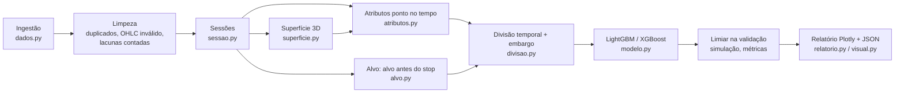

# Superfícies 3D e predição intradiária — fase 1 (MVP)

Pacote `superficie/` (Python). Gera a superfície tridimensional de mercado de um ou mais ativos,
treina um classificador de continuação/exaustão de curto prazo e entrega relatório interativo
(Plotly) com métricas fora da amostra.

```
python -m superficie                                          # BTCUSDT, 24 meses, alvo 0,5%, stop 0,3%, 30 min
python -m superficie --ativos BTCUSDT,ETHUSDT,WIN             # um ou mais ativos
python -m superficie --ativos auto --alvo 0.3,0.5,0.8 --stop 0.3,0.5 --horizonte 15,30,60   # melhor ativo e configuração
python -m superficie --validacao walkforward --folds 6
python testes/test_superficie.py                              # testes de vazamento, alvo e divisão
```
No Windows: `Simulador Python (Windows).bat`, opções 7 (escolher ativos e parâmetros) e 8 (automático).

## 1. Fluxo



| Módulo | Responsabilidade |
|---|---|
| `dados.py` | Baixa candles de 15 min (Binance Data Vision com saldo de agressão; TradingView para B3), cache local, limpeza e relatório de qualidade. Não preenche lacunas. |
| `sessao.py` | Sessão (cripto: dia UTC; B3: dia em Brasília a partir das 09:00), índice do candle no dia, abertura da sessão, oscilação % (eixo Y), máxima/mínima do dia até o candle. |
| `superficie.py` | Grade de oscilação (±5% em faixas de 0,1% por padrão), cubos S (volume) e A (agressão) por sessão × horário × faixa, superfície histórica das sessões anteriores, suavização. |
| `atributos.py` | 26 atributos ponto no tempo (preço, volatilidade, volume relativo ao mesmo horário, agressão, perfil da superfície parcial do dia, anomalias contra a superfície histórica). |
| `alvo.py` | Rótulo: atinge o alvo antes do stop dentro do horizonte (continuação, compra ou venda). |
| `divisao.py` | 70/15/15 em ordem cronológica ou walk-forward de janela crescente, ambos com embargo. |
| `modelo.py` | Treino com parada antecipada na validação, escolha do limiar, matriz de confusão, precisão, recall, F1, AUC, Brier e simulação de operações (Sharpe bruto e líquido). |
| `pipeline.py` | Orquestra; otimiza alvo/stop/horizonte, modelo e hiperparâmetros na validação; modo `auto` escolhe o ativo. |
| `visual.py`, `relatorio.py` | Superfícies 3D (volume, agressão, sessão, anomalia), mapa de calor, matriz, importâncias, curvas, calibração; controles por eixo X, Y, Z (barra, lista de % e % livre). |

## 2. A superfície

- **X** — horário da sessão, discretizado em candles de 15 min (96 por dia em cripto; ~38 na B3).
- **Y** — oscilação % do preço em relação à abertura da sessão: `(close / open_sessão − 1) × 100`. A
  abertura é o `open` do primeiro candle da sessão, conhecida desde o início do dia.
- **Z** — volume financeiro negociado na célula (horário × faixa de oscilação). Por padrão, o volume do
  candle vai inteiro para a faixa do preço de fechamento (`--alocacao fechamento`, sem supor nada sobre
  o que aconteceu dentro do candle). `--alocacao faixa` distribui igualmente entre as faixas percorridas
  (aproximação de perfil de volume). Quando a fonte informa, uma segunda superfície guarda o **saldo
  líquido de agressão** (compras agressoras − vendas agressoras).
- **Suavização controlada**: filtro gaussiano (σ tempo = 1 candle, σ oscilação = 1,5 faixa) na superfície
  histórica. Na superfície parcial do próprio dia, só no eixo da oscilação.

## 3. Prevenção de vazamento (point-in-time)

1. **Normalização incremental**: nenhum atributo usa média, desvio ou quantil do conjunto inteiro. Os
   relativos (volume do candle, volume acumulado, agressão) comparam com o **mesmo horário das N sessões
   anteriores** (`rolling(N).mean().shift(1)` por sessão).
2. **Superfície histórica** da sessão *d* = média e desvio das superfícies acumuladas das sessões
   *d−N … d−1*. A sessão corrente nunca entra na própria referência.
3. **Superfície parcial**: o candle *t* vê só a soma do próprio dia até *t*. A suavização do dia é só no
   eixo da oscilação; suavizar no tempo misturaria candles futuros.
4. **Alvo** olha para frente por construção. Por isso a divisão aplica **embargo**: linhas cujo
   horizonte cruza para o bloco seguinte saem do bloco anterior.
5. **Seleção**: modelo, hiperparâmetros, limiar de probabilidade, alvo/stop/horizonte e ativo são
   escolhidos **só na validação**. O teste é usado uma vez, para a configuração vencedora.
6. **Sem embaralhar**: blocos de sessões em ordem cronológica (70/15/15) ou walk-forward.
7. **Teste automático** (`testes/test_superficie.py`): altera preços, volumes e agressão depois de um
   instante e confirma que todos os 26 atributos anteriores a ele ficam idênticos.

## 4. Alvo e simulação

- Entrada no fechamento do candle *t*. `y = 1` se o preço anda o **alvo** (ex.: 0,5%) a favor antes de
  tocar o **stop** (ex.: 0,3%) dentro do **horizonte** (ex.: 30 min = 2 candles). Alvo e stop no mesmo
  candle contam como stop (conservador; não há dado de dentro do candle).
- Lado `continuacao` (padrão): a favor do movimento do dia até *t* (dia positivo → alvo para cima).
  `long` e `short` também disponíveis. Na B3 a operação não atravessa a noite.
- Simulação: uma posição por vez; sai no alvo, no stop ou no fim do horizonte (pelo fechamento).
  Sharpe anualizado sobre o resultado diário (365 dias em cripto, 252 na B3). **Bruto** = sem custos;
  **líquido** = com `--custo` por operação (padrão 0,10% ida e volta). Referência: entrar em toda
  oportunidade, sem modelo.

## 5. Escolha de ativos

- `--ativos BTCUSDT,ETHUSDT,WIN` — um relatório com uma seção por ativo e a comparação entre eles.
- `--ativos auto` — avalia 10 criptos líquidas (ou a lista dada junto: `auto,BTCUSDT,WIN`) com a
  configuração pedida, escolhe o maior Sharpe líquido **na validação** e então otimiza alvo, stop,
  horizonte, modelo e hiperparâmetros só nele.

## 6. Fontes e limitações conhecidas

| Fonte | Cobertura | Agressão | Observação |
|---|---|---|---|
| Binance Data Vision | completa desde 2017 (15 min) | sim (taker buy) | arquivos oficiais públicos |
| TradingView sem conta | ~5.000 candles (~6 meses em 15 min) | não | volume financeiro = volume × preço típico |

- **WIN/WDO com 24 meses e saldo de agressão real** exigem um feed pago da B3: Profit/Nelogica, Cedro,
  CMA, B3 UMDF/Market Data, ou TradingView com conta paga. O pipeline aceita os ~6 meses disponíveis e
  avisa no relatório. Rodar periodicamente acumula histórico no cache.
- O `close` do candle é o preço de entrada; deslizamento (slippage) além do custo não é modelado.
- Dentro do candle não há sequência de preços: alvo e stop no mesmo candle contam como stop.

## 7. Cronograma estimado

| Fase | Entrega | Prazo |
|---|---|---|
| 1 — MVP (esta entrega) | ingestão e limpeza, superfície 3D e visualização, atributos ponto no tempo, LightGBM/XGBoost, 70/15/15 e walk-forward, relatório com matriz, precisão, recall e Sharpe, testes de vazamento | concluída |
| 2 — Dados B3 completos | integrar feed com 24+ meses de WIN/WDO e agressão real (depende da contratação do feed) | 1 a 2 semanas após o acesso ao feed |
| 3 — Robustez estatística | purged k-fold com embargo (López de Prado), calibração isotônica, teste de significância do Sharpe (deflated Sharpe), custos e deslizamento por ativo | 2 semanas |
| 4 — Modelos avançados | redes convolucionais sobre a superfície (a matriz X×Y×Z como imagem), sequências (TCN/LSTM), ensembles; comparação com o benchmark de árvores | 3 a 4 semanas |
| 5 — Operação | atualização incremental diária, monitoramento de deriva (PSI), painel de sinais | 2 semanas |

## 8. Dependências técnicas

- Python 3.11+; `numpy`, `pandas`, `scipy`, `lightgbm`, `xgboost`, `scikit-learn`, `plotly`,
  `websocket-client` (ver `requirements.txt`).
- Internet para a primeira carga (Binance Data Vision e TradingView); depois tudo fica em cache local
  (`dados_intradia/`).
- Para a B3 com histórico longo e agressão: feed pago (ver seção 6).
