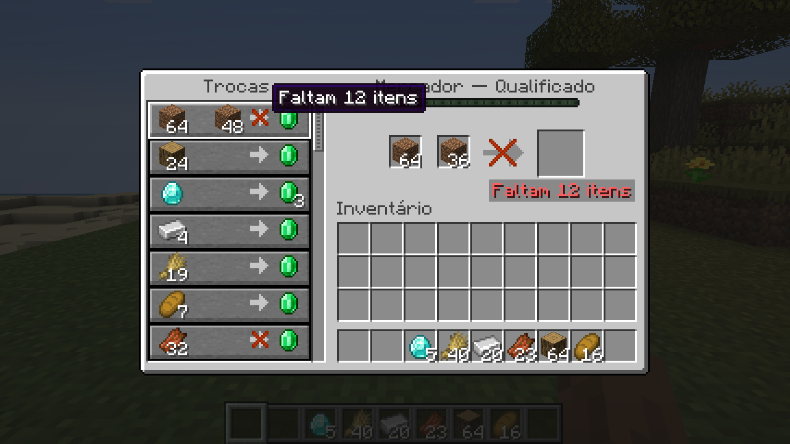
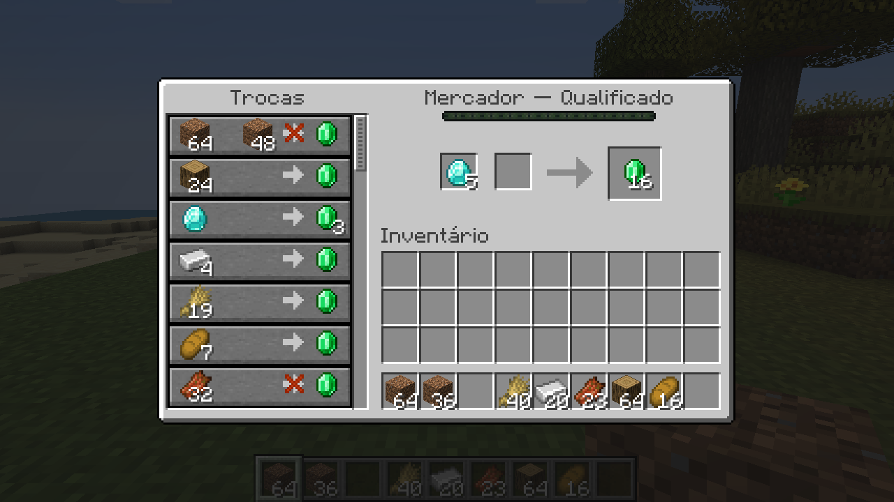
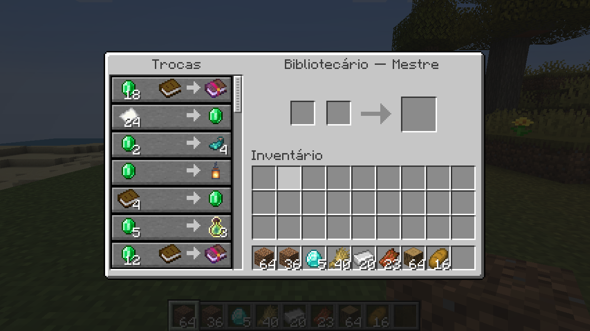

# Trocas Martins — mod de aldeões para Minecraft

Mod para **Minecraft Java 1.21.1** (Fabric) que:

1. **Adiciona trocas novas para todas as profissões de aldeão** (e para o mascate).
2. **Cria uma profissão nova, o Mercador**, com um bloco de trabalho craftável, o **Balcão do Mercador**.
   O Mercador **compra qualquer item**: você coloca o item e a quantidade e ele diz quantas esmeraldas paga.
   Se não der para fechar nem 1 esmeralda, aparece o **X vermelho** de troca impossível e um campo
   mostrando **quantos itens ainda faltam**.


## Instalação

1. Instale o [Fabric Loader](https://fabricmc.net/use/installer/) para o Minecraft **1.21.1**.
2. Baixe o [Fabric API](https://modrinth.com/mod/fabric-api) para 1.21.1 e coloque na pasta `mods`.
3. Coloque o arquivo [`download/trocas-martins-1.0.0.jar`](download/trocas-martins-1.0.0.jar) na pasta `mods`
   (`%appdata%\.minecraft\mods` no Windows).
4. Abra o Minecraft com o perfil do Fabric.

Em servidor: o mod precisa estar no servidor **e** nos jogadores (por causa da tela do Mercador).

## O Mercador

### Balcão do Mercador (receita)

| | | |
|---|---|---|
| Laje de madeira | Laje de madeira | Laje de madeira |
| Esmeralda | Baú | Esmeralda |
| Tábuas | Tábuas | Tábuas |

Coloque o Balcão perto de um aldeão desempregado e ele vira **Mercador** (chapéu marrom e túnica verde),
igual acontece com a mesa de cartografia, o atril etc. O Balcão é um armário de abeto com pano verde,
esmeraldas e moedas de ouro em cima, e fica na aba "Blocos funcionais" do criativo.

### Como vender

Clique com o botão direito no Mercador. Abre a **mesma tela de trocas dos aldeões**:

- **À esquerda, a lista de trocas**: um item de cada tipo que você tem no inventário e que o Mercador
  compra, com a quantidade que ele pede e as esmeraldas que paga (ex.: 64 + 48 terras → 1 esmeralda).
  Se você não tem o suficiente, a seta vira o **X vermelho**; passe o mouse nele para ver
  **quantos itens faltam**.
- **Clicar numa troca** coloca os itens nos 2 espaços de pagamento, como numa troca normal.
  Você também pode arrastar os itens para lá com a mão.
- **No resultado** aparecem as esmeraldas. Ele usa só os itens necessários e o resto fica no pagamento.
- Se o que está no pagamento não fecha 1 esmeralda, aparece o **X vermelho grande** (o mesmo das trocas
  esgotadas) e, embaixo dele, o aviso **"Faltam N itens"**. Também avisa se você misturar itens
  diferentes ou colocar algo que ele não compra.
- **Shift + clique** nas esmeraldas vende tudo daquele item que estiver no seu inventário.
- A barra de experiência do aldeão funciona como nas trocas normais: vender sobe o nível do Mercador.

| Faltam itens | Proposta aceita |
|---|---|
|  |  |

### Como o preço é calculado

- **Matérias-primas** têm um preço base (ex.: terra 125 por esmeralda, trigo 20 por esmeralda,
  lingote de ferro 0,3, diamante 3 esmeraldas).
- **Itens fabricados** valem a soma dos ingredientes da receita × 90%. Isso funciona sozinho para
  todos os itens do jogo, **inclusive itens de outros mods** que tenham receita.
- Itens sem receita e sem preço usam um valor pela raridade.
- Nada vale menos que 1 esmeralda a cada 125 itens, para sempre caber nos 2 espaços de pagamento.
- **Durabilidade**: ferramenta gasta vale menos. **Encantamentos** aumentam o valor
  (maldições não contam). **Caixas de shulker** contam o que tem dentro.
- O Mercador paga no máximo **64 esmeraldas por item**.
- **Mercador experiente paga mais**: +4% por nível, mais um bônus pela sua reputação na vila e pelo
  efeito Herói da Vila (total limitado a +20%). Vender para ele dá experiência e ele sobe de nível.
- Itens únicos (armaduras, ferramentas...) comprados de outros aldeões: o Mercador paga no máximo
  **metade do que você pagou**, para não dar para "fabricar" esmeraldas com descontos.

### Comandos

- `/mercador preco` — quanto o Mercador paga pelo item na sua mão.
- `/mercador preco <item> [quantidade]` — ex.: `/mercador preco minecraft:dirt 200`.
- `/mercador recarregar` — relê a configuração (operadores).

### Configuração

O arquivo `config/trocasmartins.json` é criado na primeira vez que o jogo abre (exemplo):

```json
{
  "multiplicador_global": 1.0,
  "bonus_por_nivel": 0.04,
  "bonus_por_reputacao": true,
  "bonus_maximo": 0.2,
  "max_esmeraldas_por_item": 64,
  "trocas_novas_por_nivel": 1,
  "precos": {
    "minecraft:rotten_flesh": 0.03,
    "#minecraft:logs": 0.05
  }
}
```

Em `precos`, o valor é **em esmeraldas por UM item** (`0.01` = 100 itens por esmeralda; `0` = não compra).
Use `#tag` para grupos de itens. Datapacks podem adicionar itens à tag `trocasmartins:nao_compra`.

## Trocas novas das profissões

A cada nível, o aldeão recebe as 2 trocas normais do Minecraft **+ 1 troca nova** sorteada da lista
abaixo (configurável em `trocas_novas_por_nivel`). Só vale para aldeões que ainda vão ganhar trocas
(desempregados que pegarem a profissão ou aldeões que subirem de nível).

| Profissão | Novato (1) | Aprendiz (2) | Qualificado (3) | Especialista (4) | Mestre (5) |
|---|---|---|---|---|---|
| **Armeiro** | compra cobre; vende escudo | armadura de lobo; compra escama de tatu | peitoral de ferro Proteção III; botas Queda Suave III | capacete de diamante Respiração III + Afinidade Aquática; molde de acabamento sorteado | **molde de melhoria de netherite**; peitoral de diamante Proteção IV + Inquebrável III |
| **Açougueiro** | cenouras douradas; compra ossos | ensopado de coelho; bolo | bifes; compra couro de coelho | pé de coelho; torta de abóbora | maçã dourada; garrafas de mel |
| **Cartógrafo** | bússola; compra penas | luneta; molduras brilhantes | padrão de estandarte sorteado; magnetita | fragmento de eco; mapas | **bússola de recuperação**; padrão "Coisa" |
| **Clérigo** | pó de blaze; compra olho de aranha | poção de Cura; pó de pedra luminosa | lágrima de ghast; membrana de phantom | poção de Regeneração; Resistência ao Fogo; sopro do dragão | **totem da imortalidade**; poção arremessável de Cura II |
| **Fazendeiro** | frutas doces; frutas brilhantes | cacau; bambu; compra cactos | musgo; muda de cerejeira; azaleia florida | semente de flor-tocha; vagem de jarro | **ovo de farejador**; cenouras douradas |
| **Pescador** | vitórias-régias; balde com peixe tropical | fragmentos e cristais de prismarinho | esponja; **balde com axolote** | concha de náutilo; vara de pesca Sorte do Mar III + Isca III | **coração do mar**; **tridente** |
| **Flecheiro** | flechas espectrais; compra penas | cargas de vento; flechas de Lentidão | arco Força III; flechas de Veneno | besta Rajada + Recarga Rápida II; flechas de Dano | arco Infinidade + Força IV; flechas espectrais |
| **Curtidor** | laço; compra couro de coelho | armadura de cavalo de ferro; molduras | etiqueta; armadura de cavalo de ouro | armadura de cavalo de diamante; armadura de lobo | casco de tartaruga; botas Passos Profundos III + Queda Suave IV |
| **Bibliotecário** | bolsas de tinta brilhante; livro e pena | estante entalhada; frascos de experiência | livros Eficiência IV / Proteção IV / Afiação IV | livros Inquebrável III / Fortuna III / Pilhagem III | livros **Remendo** / Toque Suave / Agachamento Ágil III |
| **Pedreiro** | calcita; tijolos de tufo | obsidiana; tijolos de lama | obsidiana chorona; aglomerados de ametista | tijolos de pedra do End; purpur; espeleotemas | lanternas do mar; luzes de sapo |
| **Pastor** | teias; compra linha | lã colorida sorteada; pinturas | velas coloridas; tear | padrões "Focinho" e "Globo" | **disco de música sorteado**; toca-discos |
| **Ferramenteiro** | pincel; compra cobre | luneta; tesoura | picareta de ferro Eficiência III; pá Eficiência III + Inquebrável II | picareta de diamante Fortuna III; machado Eficiência IV | picareta Eficiência V + Inquebrável III; **fragmento de netherite** |
| **Armeiro de armas** | escudo; compra ferro | espada de ferro Afiação II; cargas de vento | machado Afiação III; vara de breeze | espada de diamante Afiação IV + Pilhagem II | **núcleo pesado** (para a maça); espada Afiação V + Aspecto Flamejante II |
| **Mascate** | frascos de experiência; vagem de jarro; semente de flor-tocha | fragmento de cerâmica sorteado; etiqueta; ovo de farejador (raras) | | | |



## Para desenvolvedores

Requer Java 21.

```bash
./gradlew build          # gera build/libs/trocas-martins-1.0.0.jar
./gradlew runClient      # abre o jogo com o mod
./gradlew runGametest    # testes automáticos num servidor de verdade
xvfb-run ./gradlew runFotos   # tira as fotos da pasta docs/ (opcional)
python3 tools/gerar_texturas.py   # recria a roupa do Mercador
```

Código principal em `src/main/java/com/martins/trocas`:

- `mercador/PrecoMercador.java` — cálculo dos preços e da proposta.
- `mercador/TabelaPrecos.java` — preços-base das matérias-primas.
- `mercador/MercadorScreenHandler.java` / `client/MercadorScreen.java` — a tela de trocas do Mercador.
- `trocas/NovasTrocas.java` — as trocas novas de cada profissão.
