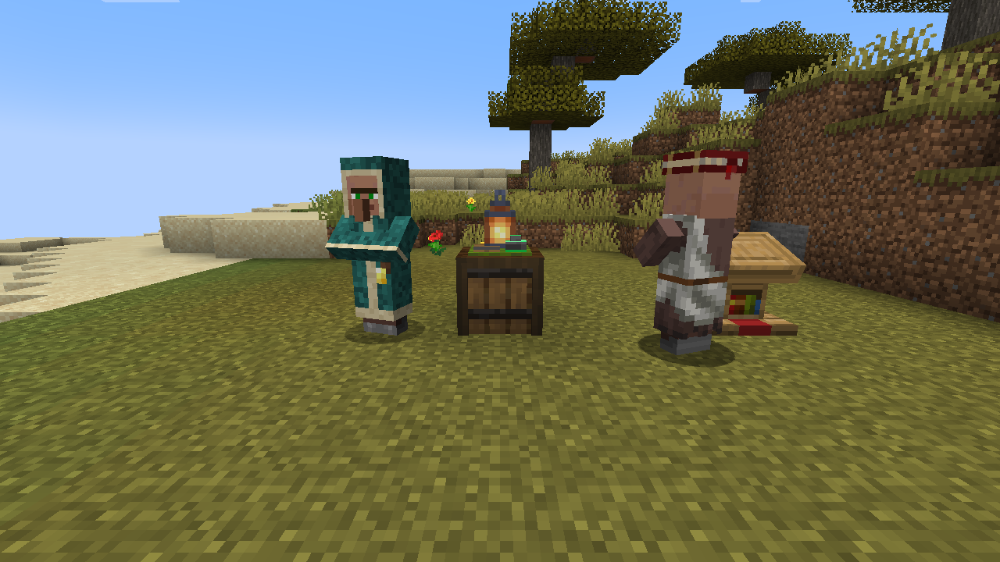
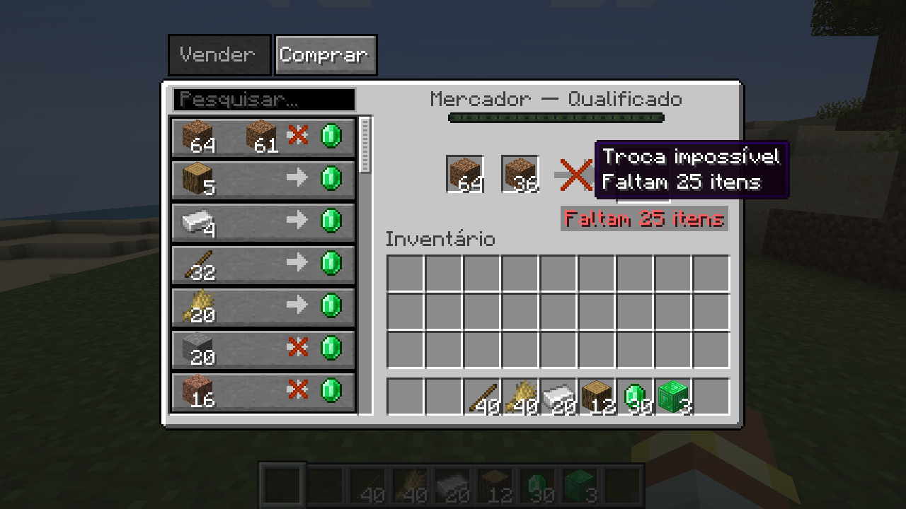
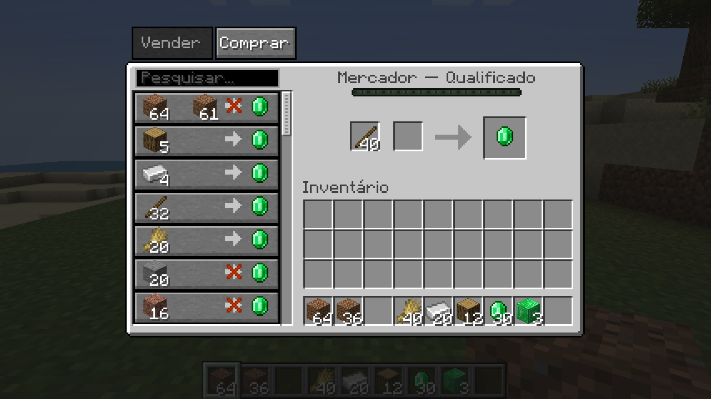
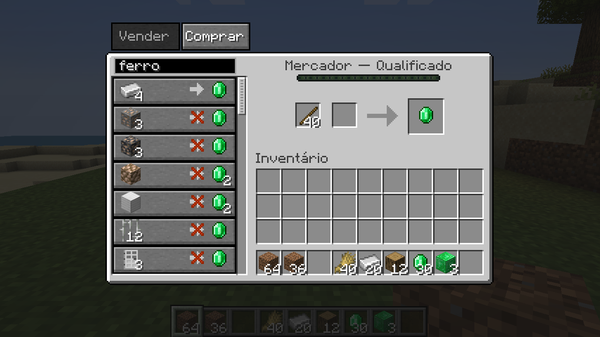
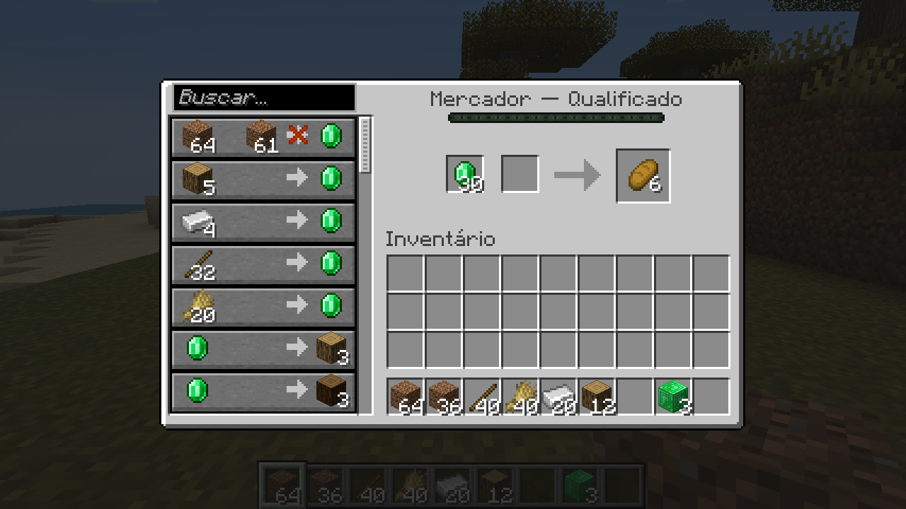
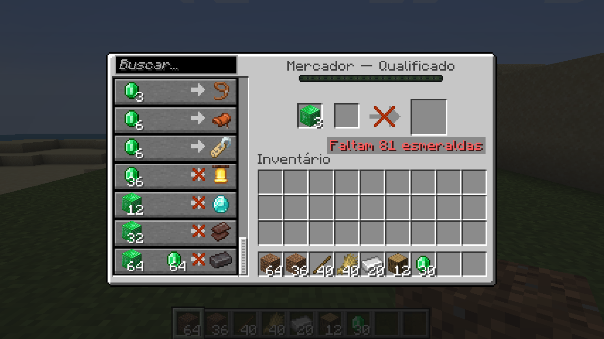
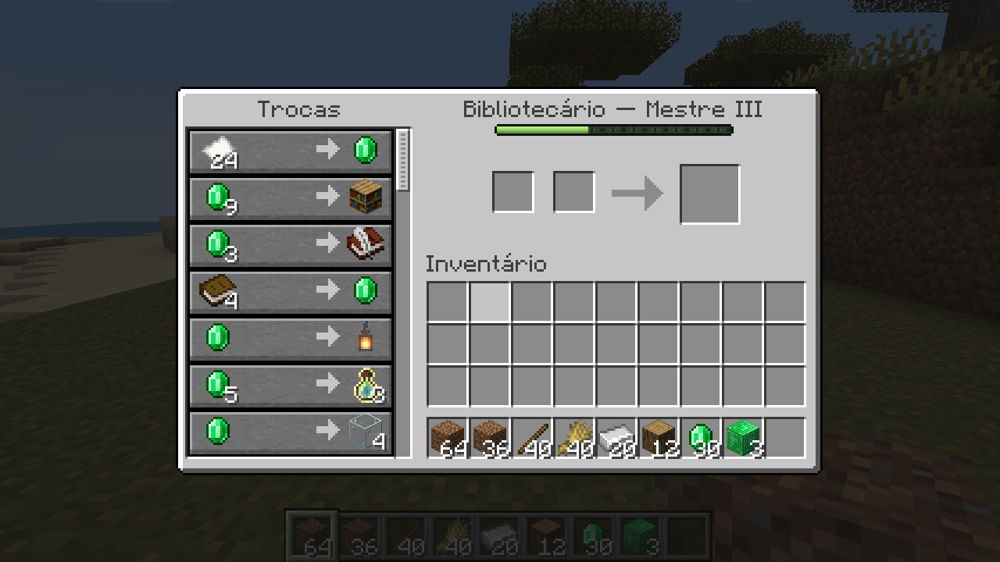

# Trocas Martins — mod de aldeões para Minecraft

Mod para **Minecraft Java 1.21.1** (Fabric) que:

1. **Adiciona trocas novas para todas as profissões de aldeão** (e para o mascate).
2. **Cria uma profissão nova, o Mercador**, com um bloco de trabalho craftável, o **Balcão do Mercador**.
   O Mercador **compra praticamente qualquer item do jogo** pelo mesmo preço que os outros aldeões pagam,
   e também **vende** uma lista de itens variados. Se não der para fechar a troca, aparece o
   **X vermelho** de troca impossível e quantos itens (ou esmeraldas) ainda faltam.



## Instalação

1. Instale o [Fabric Loader](https://fabricmc.net/use/installer/) para o Minecraft **1.21.1**.
2. Baixe o [Fabric API](https://modrinth.com/mod/fabric-api) para 1.21.1 e coloque na pasta `mods`.
3. Coloque o arquivo [`download/trocas-martins-1.0.0.jar`](download/trocas-martins-1.0.0.jar) na pasta `mods`
   (`%appdata%\.minecraft\mods` no Windows).
4. Abra o Minecraft com o perfil do Fabric.

Em servidor: o mod precisa estar no servidor **e** nos jogadores (por causa da tela do Mercador).

## O Mercador

### Balcão do Mercador (receita)

| | | |
|---|---|---|
| Laje de madeira | Laje de madeira | Laje de madeira |
| Esmeralda | Baú | Esmeralda |
| Tábuas | Tábuas | Tábuas |

Coloque o Balcão perto de um aldeão desempregado e ele vira **Mercador**: capuz e manto no estilo do
mascate, mas verde-azulados, com cinto de couro e uma esmeralda na fivela,
igual acontece com a mesa de cartografia, o atril etc. O Balcão é um armário de abeto com pano verde,
esmeraldas e moedas de ouro em cima, e fica na aba "Blocos funcionais" do criativo.

### A tela do Mercador

Clique com o botão direito no Mercador. Abre a **mesma tela de trocas dos aldeões**, com uma **lista só**
(vender e comprar juntos, como num aldeão normal) e a **pesquisa igual à do livro de receitas** em cima dela.

- **Primeiro** aparecem os itens do seu inventário que ele compra (ex.: 32 gravetos → 1 esmeralda);
  **depois**, o que ele vende (ex.: 1 esmeralda → 6 pães).
- **Pesquisando** (ex.: "ferro", "tronco"), aparecem também todos os outros itens do jogo que ele compra.
- Se você não tem o suficiente, a seta vira **X vermelho**; passe o mouse para ver **quantos itens
  ou esmeraldas faltam**.
- **Clicar numa troca** coloca os itens (ou as esmeraldas) nos 2 espaços de pagamento.
  Também dá para **soltar qualquer item** direto no pagamento: ele avalia na hora.
- Se não fecha, aparece o **X grande** e o aviso **"Faltam N itens"** / **"Faltam N esmeraldas"**.
- **Shift + clique** no resultado repete a troca enquanto der.

**Limite de trocas, igual aos aldeões:** cada item pode ser vendido a ele **16 vezes** e cada item da loja
comprado **12 vezes** (diamante e netherite: **1 vez**). Depois aparece "Esgotado por enquanto".
Ele repõe trabalhando no Balcão, até 2 vezes por dia, como qualquer aldeão.

| Faltam itens | 32 gravetos = 1 esmeralda |
|---|---|
|  |  |
| **Pesquisa** | **Comprar pão** |
|  |  |



### Preços justos (sem lucro, sem prejuízo absurdo)

O Mercador lê, quando o mundo abre, **todas as trocas de todos os aldeões** (as do Minecraft, as do
mascate, as deste mod e as de outros mods) e segue estas regras:

**Quando você vende:**
1. Se algum aldeão compra o item, o Mercador paga **exatamente o mesmo**.
   Ex.: o flecheiro compra 32 gravetos por 1 esmeralda, então o Mercador também. Trigo: 20. Papel: 24.
   Lingote de ferro: 4. Diamante: 1 (igual ao armeiro).
2. Matéria-prima que vira um desses itens vale **95% do que ela rende**. Ex.: 1 tronco = 4 tábuas =
   8 gravetos = 0,25 esmeralda no flecheiro, então o Mercador paga 1 esmeralda a cada **5 troncos**.
   Você perde só um pouquinho por não fazer os gravetos.
3. Item fabricado vale **95% da soma dos ingredientes**.
4. O que sobrar usa uma tabela de matérias-primas (ex.: terra: 125 por esmeralda).
5. **Trava contra lucro**: o Mercador nunca paga mais que 90% do que custa comprar o item
   (ou os ingredientes dele) de qualquer aldeão.

**Quando você compra:**
1. Se algum aldeão ou o mascate vende o item, o Mercador cobra **a mesma troca**
   (ex.: muda de árvore 5 esmeraldas, como o mascate; pão 6 por 1, como o fazendeiro).
2. Se ninguém vende, cobra **25% a mais** do que ele mesmo pagaria. Comprar e revender sempre dá prejuízo.
3. **Diamante e netherite** existem, mas com preço absurdo de propósito: diamante = 12 blocos de
   esmeralda (108), fragmento de netherite = 32 blocos (288), lingote de netherite = 64 blocos + 64 esmeraldas (640).
4. Nada de élitro, totem, estrela do Nether e afins.

A loja tem madeiras, pedras, areia, argila, gelo, obsidiana, mudas, plantas, sementes, comida,
carvão, ferro, cobre, ouro, redstone, lápis, quartzo, linha, couro, penas, ossos, pólvora, slime,
papel, livros, pérolas do Ender, frascos de experiência, tochas, lanternas, baldes, tesoura, bússola,
relógio, mapas, flechas, laço, sela, etiqueta e sino.

Os testes automáticos conferem essas regras para **todos** os itens do jogo a cada versão.

Mais detalhes:
- **Durabilidade**: ferramenta gasta vale menos. **Encantamentos** aumentam o valor.
  **Caixas de shulker** contam o que tem dentro.
- O Mercador paga no máximo **64 esmeraldas por item**.
- Itens únicos (armaduras, ferramentas...) comprados de outros aldeões: o Mercador paga no máximo
  **metade do que você pagou**.
- Vender e comprar dá experiência ao Mercador e ele sobe de nível (o preço não muda com o nível).

### Comandos

- `/mercador preco` — quanto o Mercador paga pelo item na sua mão.
- `/mercador preco <item> [quantidade]` — ex.: `/mercador preco minecraft:dirt 200`.
- `/mercador recarregar` — relê a configuração (operadores).

### Configuração

O arquivo `config/trocasmartins.json` é criado na primeira vez que o jogo abre (exemplo):

```json
{
  "multiplicador_global": 1.0,
  "max_esmeraldas_por_item": 64,
  "trocas_novas_por_nivel": 1,
  "precos": {
    "minecraft:rotten_flesh": 0.03,
    "#minecraft:logs": 0.05
  }
}
```

Em `precos` você fixa quanto o Mercador paga, **em esmeraldas por UM item** (`0.01` = 100 itens por esmeralda; `0` = não compra).
Use `#tag` para grupos de itens. Datapacks podem adicionar itens à tag `trocasmartins:nao_compra`.

## Trocas novas das profissões

A cada nível, o aldeão recebe as 2 trocas normais do Minecraft **+ 1 troca nova** sorteada da lista
abaixo (configurável em `trocas_novas_por_nivel`). Só vale para aldeões que ainda vão ganhar trocas
(desempregados que pegarem a profissão ou aldeões que subirem de nível).

| Profissão | Novato (1) | Aprendiz (2) | Qualificado (3) | Especialista (4) | Mestre (5) |
|---|---|---|---|---|---|
| **Armeiro** | compra cobre; vende escudo | armadura de lobo; compra escama de tatu | peitoral de ferro Proteção III; botas Queda Suave III | capacete de diamante Respiração III + Afinidade Aquática; molde de acabamento sorteado | **molde de melhoria de netherite**; peitoral de diamante Proteção IV + Inquebrável III |
| **Açougueiro** | cenouras douradas; compra ossos | ensopado de coelho; bolo | bifes; compra couro de coelho | pé de coelho; torta de abóbora | maçã dourada; garrafas de mel |
| **Cartógrafo** | bússola; compra penas | luneta; molduras brilhantes | padrão de estandarte sorteado; magnetita | fragmento de eco; mapas | **bússola de recuperação**; padrão "Coisa" |
| **Clérigo** | pó de blaze; compra olho de aranha | poção de Cura; pó de pedra luminosa | lágrima de ghast; membrana de phantom | poção de Regeneração; Resistência ao Fogo; sopro do dragão | **totem da imortalidade**; poção arremessável de Cura II |
| **Fazendeiro** | frutas doces; frutas brilhantes | cacau; bambu; compra cactos | musgo; muda de cerejeira; azaleia florida | semente de flor-tocha; vagem de jarro | **ovo de farejador**; cenouras douradas |
| **Pescador** | vitórias-régias; balde com peixe tropical | fragmentos e cristais de prismarinho | esponja; **balde com axolote** | concha de náutilo; vara de pesca Sorte do Mar III + Isca III | **coração do mar**; **tridente** |
| **Flecheiro** | flechas espectrais; compra penas | cargas de vento; flechas de Lentidão | arco Força III; flechas de Veneno | besta Rajada + Recarga Rápida II; flechas de Dano | arco Infinidade + Força IV; flechas espectrais |
| **Curtidor** | laço; compra couro de coelho | armadura de cavalo de ferro; molduras | etiqueta; armadura de cavalo de ouro | armadura de cavalo de diamante; armadura de lobo | casco de tartaruga; botas Passos Profundos III + Queda Suave IV |
| **Bibliotecário** | bolsas de tinta brilhante; livro e pena | estante entalhada; frascos de experiência | livros Eficiência IV / Proteção IV / Afiação IV | livros Inquebrável III / Fortuna III / Pilhagem III | livros **Remendo** / Toque Suave / Agachamento Ágil III |
| **Pedreiro** | calcita; tijolos de tufo | obsidiana; tijolos de lama | obsidiana chorona; aglomerados de ametista | tijolos de pedra do End; purpur; espeleotemas | lanternas do mar; luzes de sapo |
| **Pastor** | teias; compra linha | lã colorida sorteada; pinturas | velas coloridas; tear | padrões "Focinho" e "Globo" | **disco de música sorteado**; toca-discos |
| **Ferramenteiro** | pincel; compra cobre | luneta; tesoura | picareta de ferro Eficiência III; pá Eficiência III + Inquebrável II | picareta de diamante Fortuna III; machado Eficiência IV | picareta Eficiência V + Inquebrável III; **fragmento de netherite** |
| **Armeiro de armas** | escudo; compra ferro | espada de ferro Afiação II; cargas de vento | machado Afiação III; vara de breeze | espada de diamante Afiação IV + Pilhagem II | **núcleo pesado** (para a maça); espada Afiação V + Aspecto Flamejante II |
| **Mascate** | frascos de experiência; vagem de jarro; semente de flor-tocha | fragmento de cerâmica sorteado; etiqueta; ovo de farejador (raras) | | | |

### Níveis infinitos depois de Mestre

Depois de **Mestre**, os aldeões continuam evoluindo: **Mestre II, Mestre III, Mestre IV...** sem fim.

- Para subir, é preciso **completar a barra de experiência do nível atual** trocando com ele
  (a barra continua aparecendo depois de Mestre).
- Cada nível pede mais experiência que o anterior: Mestre II = 450, III = 700, IV = 1000, V = 1350...
- Cada nível novo traz **uma troca mais forte** da profissão (as apelonas):

| Profissão | Trocas dos níveis Mestre II em diante (em ordem) |
|---|---|
| **Armeiro** | capacete de diamante Proteção IV + Respiração III; calças Proteção IV + Inquebrável III; botas Queda Suave IV + Passos Profundos III; molde de netherite; peitoral Proteção IV + Inquebrável III + Remendo; lingote de netherite; moldes Silêncio e Torre; **armadura de netherite completa** (capacete, peitoral, calças e botas com tudo no máximo + Remendo) |
| **Açougueiro** | 3 maçãs douradas; 16 cenouras douradas; 4 pés de coelho; maçã dourada encantada |
| **Cartógrafo** | bússola de recuperação; fragmentos de eco; magnetitas; **élitro** |
| **Clérigo** | 16 frascos de experiência; olhos do Ender; sopro do dragão; **totem**; cascos de shulker; **estrela do Nether**; caveira de wither esqueleto; cristais do End; **ovo do dragão** |
| **Fazendeiro** | melancias reluzentes; ovo de farejador; 32 cenouras douradas; maçã dourada encantada |
| **Pescador** | conchas de náutilo; vara Sorte do Mar III + Isca III + Remendo; coração do mar; **tridente** Lealdade III + Empalamento III; **conduíte**; tridente Correnteza III + Empalamento V + Remendo |
| **Flecheiro** | flechas de Dano II; arco Força V + Infinidade + Chama; besta Rajada + Recarga Rápida III + Remendo; varas de breeze; arco Força V + Infinidade + Inquebrável III + Impacto II; besta Perfuração IV + Recarga Rápida III + Remendo |
| **Curtidor** | selas; casco de tartaruga encantado; cascos de shulker; **élitro**; élitro Inquebrável III + Remendo |
| **Bibliotecário** | livros Afiação V; Eficiência V; Proteção IV; Agachamento Ágil III; Velocidade das Almas III; Passos Gelados II; Remendo (mais barato); e **todos os outros no máximo**: Inquebrável III, Fortuna III, Pilhagem III, Toque Suave, Força V, Infinidade, Espinhos III, Passos Profundos III, Respiração III, Queda Suave IV, Rajada de Vento III, Densidade V, Ruptura IV, Correnteza III, Condutividade |
| **Pedreiro** | obsidiana chorona; catalisador de sculk; detrito ancestral; **sinalizador**; caixa de shulker; chave de desafio sinistra |
| **Pastor** | discos Pigstep, Otherside, Relic, Creator e Precipice; cabeça de dragão; padrão Fluxo |
| **Ferramenteiro** | picaretas de diamante Eficiência V com Fortuna III ou Toque Suave; fragmentos de netherite; molde de netherite; picareta Eficiência V + Fortuna III + Inquebrável III + Remendo; **picareta, machado e pá de netherite** no máximo + Remendo |
| **Armeiro de armas** | espada Afiação V + Pilhagem III; **núcleo pesado**; machado Afiação V; **maça**; espada Afiação V + Aspecto Flamejante II + Pilhagem III + Remendo; **maça** Densidade V + Rajada de Vento III + Remendo; **espada de netherite** com tudo no máximo + Remendo |

**Depois que o aldeão entrega todos os itens mais fortes da profissão**, os níveis seguintes alternam:

- **Otimizar** (Mestre ímpar depois da lista): uma das trocas fortes fica **15% mais barata e ganha 1 uso**,
  uma de cada vez, em rodízio. Com o tempo tudo fica cada vez mais acessível.
- **Inovar** (Mestre par depois da lista): aparece uma **troca nova sorteada**, que pode ser:
  - um livro de **qualquer encantamento do jogo no nível máximo**;
  - uma peça de netherite, maça, tridente, arco, besta, vara ou élitro com até 4 encantamentos no máximo;
  - um item forte de qualquer profissão **em dobro**.

Assim a progressão nunca termina: cada nível exige mais experiência e sempre traz algo melhor.




## Para desenvolvedores

Requer Java 21.

```bash
./gradlew build          # gera build/libs/trocas-martins-1.0.0.jar
./gradlew runClient      # abre o jogo com o mod
./gradlew runGametest    # testes automáticos num servidor de verdade
xvfb-run ./gradlew runFotos   # tira as fotos da pasta docs/ (opcional)
python3 tools/gerar_texturas.py   # recria a roupa do Mercador
```

Código principal em `src/main/java/com/martins/trocas`:

- `mercador/PrecoMercador.java` — cálculo dos preços e da proposta.
- `mercador/TrocasAldeoes.java` — lê as trocas de todos os aldeões.
- `mercador/LojaMercador.java` — o que o Mercador vende.
- `mercador/TabelaPrecos.java` — preços-base das matérias-primas sem relação com aldeões.
- `mercador/MercadorScreenHandler.java` / `client/MercadorScreen.java` — a tela de trocas do Mercador.
- `trocas/NovasTrocas.java` — as trocas novas de cada profissão.
